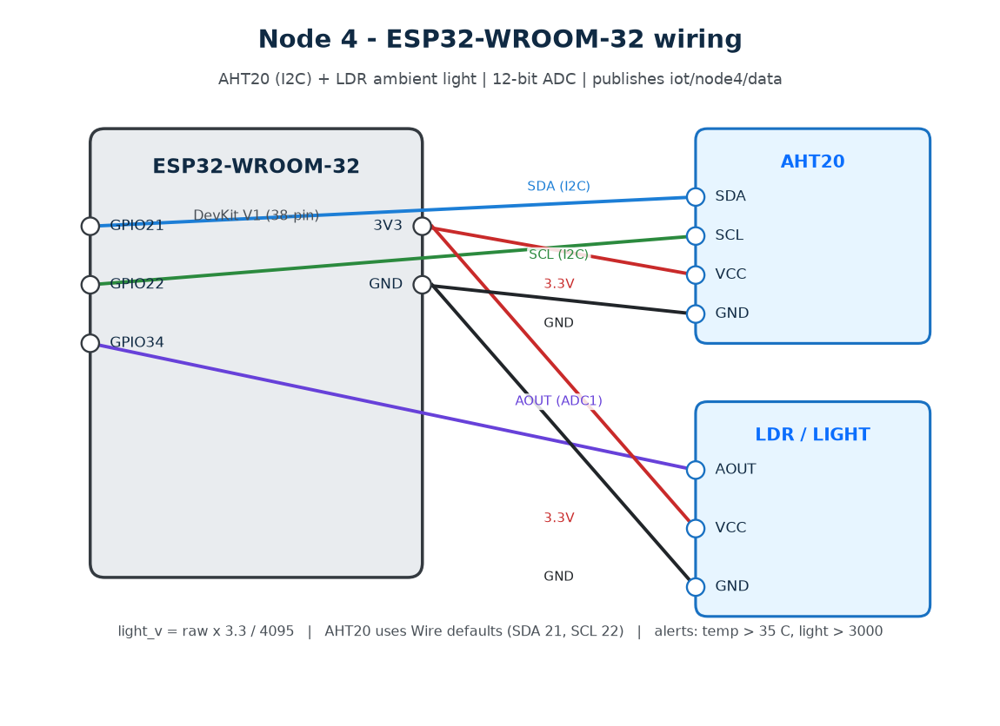
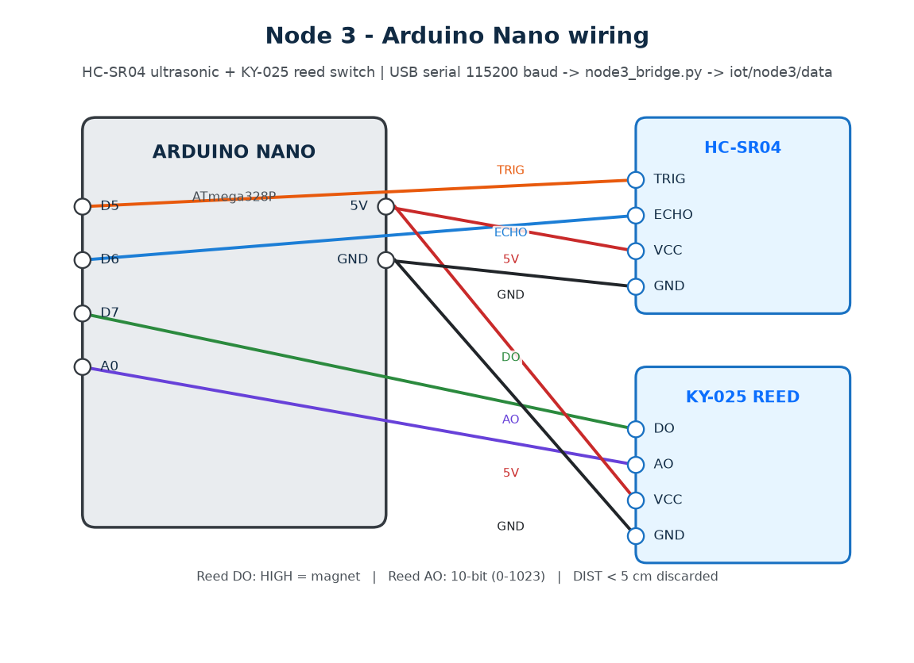

# IoT Trust Testbed — Honours Project (4165489)

**Evaluating trust-based robustness in a heterogeneous IoT network**

A hardware testbed that computes a **Behavioural Trust Index (BTI)** from live
MQTT telemetry and measures how that score responds to protocol-compliant
attacks. Three ESP32 nodes and one Arduino Nano publish sensor readings to a
broker on a gateway; a Dash dashboard scores each node in real time.

> **Security note:** every credential, device address and tunnel URL in this
> repository is a placeholder. Real values belong in a local `.env` file (see
> `.env.example`) and must never be committed.

> **Scope and ethics:** the attack clients in `src/` are research tooling for
> this project's isolated testbed only. They authenticate to a broker you
> control and publish telemetry-shaped MQTT messages to evaluate the behaviour
> of the trust score. They do not exploit vulnerabilities, target external
> systems or flood network infrastructure. Run them only on a network you own
> or are explicitly authorised to test.

---

## Abstract

Trust scores can complement device authentication by tracking behaviour after a
device joins an IoT network, but the evidence used to calculate those scores may
itself be manipulated. This project evaluates a fixed Behavioural Trust Index
and a separate anomaly detector on a heterogeneous hardware testbed. An
authenticated attack client publishes alongside each physical device to its
existing topic, so the experiment evaluates combined topic traffic rather than
attributing an effect to a compromised device. The archived campaign contains
three independent runs per node and attack for replay, timing manipulation,
false data injection (FDI), flooding and behaviour mimicry. Results show that
FDI is repeatedly flagged while the original frequency term can reward elevated
message rates, motivating a post-hoc rate-aware sensitivity analysis.

---

## Project overview

The system evaluates node trustworthiness from four observable communication
metrics — message frequency (**F**), inter-arrival timing (**T**), sensor data
stability (**D**) and packet size consistency (**P**) — aggregated into a
per-node score and a network-wide score. Controlled adversarial scenarios are
used to evaluate the resilience of the BTI under realistic, protocol-compliant
conditions.

All experiments were run on an isolated testbed. Attacks publish telemetry only;
they do not flood network infrastructure or interact with any external system.

---

## System architecture

```
  ESP32  node1  (DHT11 + MQ-131)   -- WiFi --> Mosquitto broker (gateway)
  ESP32  node2  (sound + light)    -- WiFi --> Mosquitto broker (gateway)
  ESP32  node4  (AHT20 + light)    -- WiFi --> Mosquitto broker (gateway)
  Nano   node3  (ultrasonic+reed) -- USB serial --> node3_bridge.py --> broker
                                                        |
                                                        v
                                     Dash dashboard + BTI engine
                                     PDF report generation
                                                        |
                                        Nginx reverse proxy / tunnel
```

| Node | Board | Sensors | Topic | Transport |
|------|-------|---------|-------|-----------|
| node1 | ESP32-WROOM-32 | DHT11 (temp, humidity), MQ-131 (ozone) | `iot/node1/data` | Wi-Fi / MQTT |
| node2 | ESP32-WROOM-32 | Analog sound, analog light | `iot/node2/data` | Wi-Fi / MQTT |
| node3 | Arduino Nano | HC-SR04 (distance), KY-025 reed switch | `iot/node3/data` | USB serial → `node3_bridge.py` |
| node4 | ESP32-WROOM-32 | AHT20 (temp, humidity), LDR (light) | `iot/node4/data` | Wi-Fi / MQTT |

Nodes subscribe to each other's topics to carry peer-liveness and network
alert state in their payloads. The dashboard subscribes to `iot/#`, so a new
node publishing `iot/nodeX/data` appears without code changes.

---

## Behavioural Trust Index (BTI)

```
BTI = w1·F + w2·T + w3·D + w4·P
```

| Metric | Meaning | Weight |
|--------|---------|--------|
| F | Message frequency consistency | 0.25 |
| T | Inter-arrival timing consistency | 0.30 |
| D | Sensor data stability | 0.25 |
| P | Packet size consistency | 0.20 |

Weights sum to 1. Temporal decay uses exponential smoothing:

```
BTI(t) = α · BTI(t-1) + (1 - α) · CurrentScore     (α = 0.7)
```

| Score | Status |
|-------|--------|
| 0.7 – 1.0 | Stable — no anomaly |
| 0.4 – 0.7 | Moderate instability |
| 0.0 – 0.4 | Critical trust degradation |

A separate per-node anomaly detector scores only numeric fields present in that
node's own baseline. Feature sets therefore differ per node — for example node3
uses distance, reed analog output and RSSI, while node4 uses temperature,
humidity, light, light voltage and RSSI.

---

## Adversarial scenarios

| Attack | Behavioural change | Main metric affected |
|--------|--------------------|----------------------|
| Replay | Repeats previously captured valid messages | F, T |
| Timing manipulation | Varies inter-arrival timing | T |
| False data injection | Perturbs sensor fields with range-bounded values | D |
| Flooding | Raises message rate | F |
| Mimicry | Drifts one sensor field slowly toward the mean | D |

The attack clients (`src/Attack_*.py`) learn a payload profile from the broker
before publishing, so injected messages keep the same schema and topic as the
real device.

---

## Results summary

Three repeats per node and attack. "Flagged" is the share of attack-phase
messages marked anomalous; "BTI change" is the mean change in the archived BTI.

| Attack | Flagged | BTI change |
|--------|---------|------------|
| False data injection | 49.8 – 64.7% | −3.0% to −11.0% |
| Replay | usually low (node4 2.2 – 27.6%) | variable |
| Timing manipulation | 0 – 4.8% | −3.6% to −7.5% |
| Flooding | 0 – 1.2% | +4.5% to +6.0% |
| Mimicry (node-aware rerun) | node3/node4 ≈ 25%, node2 mostly missed, node1 variable | small |

The flooding result exposed a weakness: the original frequency term *rewarded*
elevated rates. A post-hoc sensitivity analysis replaces that term with a
symmetric rate penalty and recomputes the same smoothed score on archived
messages, producing a 25.2 – 26.5% BTI reduction for flooding. This is a
counterfactual analysis of logged data, not a new experiment.

Full tables and per-run figures are in [`results/`](results/). See
[`docs/REPRODUCE.md`](docs/REPRODUCE.md) for how to regenerate them.

---

## Hardware

### Gateway

A Rock Pi 4 SE runs the Mosquitto broker, the Dash dashboard, the serial
bridge for node3, Nginx and an outbound tunnel client for remote viewing.

### ESP32 boards (node1, node2, node4)

ESP32-WROOM-32 DevKit V1 (38-pin). Note: **3.3 V is on the bottom right** and
**VIN (5 V) is on the bottom left** — opposite sides of the board.

- **node1** — DHT11 on GPIO 4 (3.3 V); MQ-131 analogue on GPIO 34 (5 V via VIN,
  with a voltage divider; allow 60 s warm-up).
- **node2** — sound on GPIO 35, light on GPIO 32 (both 3.3 V, both input-capable).
- **node4** — AHT20 on I²C (SDA GPIO 21, SCL GPIO 22); LDR on GPIO 34
  (ADC1, 12-bit). `light_v` is the raw ADC converted to volts.

  

### Arduino Nano (node3)

HC-SR04 on D5 (trigger) / D6 (echo); KY-025 reed switch on D7 (digital) and A0
(analogue). Connected by USB to the gateway; `node3_bridge.py` reads the serial
frames at 115200 baud and republishes them as JSON to `iot/node3/data`.



Node1 and node2 wiring diagrams are in [`images/`](images/) (`node1.png`,
`node2.png`), alongside the ESP32 pinout (`esp32.png`) and the full system
diagram (`architecture.png`). Full wiring tables are in
[`SCHEMATIC.txt`](SCHEMATIC.txt). The node3/node4 diagrams are generated by a
script kept with the project documentation so they can be regenerated.

---

## Software setup

### Install dependencies

On the gateway:

```bash
python3 -m pip install -r requirements.txt
```

Install Mosquitto and create an authenticated user; see the broker notes in
[`docs/REPRODUCE.md`](docs/REPRODUCE.md). Configure credentials through `.env`
or environment variables — the source files contain no real secrets.

### Run the system

```bash
# broker
sudo systemctl start mosquitto

# dashboard (binds 0.0.0.0:5000)
python3 src/app.py

# node3 serial bridge
python3 src/node3_bridge.py
```

Preflight checks (`src/preflight.py`) verify that all four node schemas match
before a capture run. The dashboard additionally supports local report export.

### Firmware

Sketches live in [`arduino/src/`](arduino/src/):

| File | Board |
|------|-------|
| `node1.ino` | ESP32 — DHT11 + MQ-131 |
| `node2.ino` | ESP32 — sound + light |
| `node4.ino` | ESP32 — AHT20 + light |
| `nano_node3.ino` | Arduino Nano — ultrasonic + reed (serial) |

Replace the placeholder Wi-Fi/MQTT values before flashing. Do not commit the
filled-in sketches.

---

## Repository layout

```
arduino/src/     Final firmware for all four nodes
src/             Dashboard, serial bridge, attack clients, capture/analysis tools
scripts/         Iteration runner
results/         Archived summaries and per-run CSVs
docs/            Reproduction and demo notes
images/          Pinouts and wiring diagrams
```

---

## Academic context

Submitted in partial fulfilment of the Honours degree in Computer Science at
the University of the Western Cape.

## Author

**Lavhelani Mano** — 4165489
Honours Project, University of the Western Cape, Department of Computer Science
